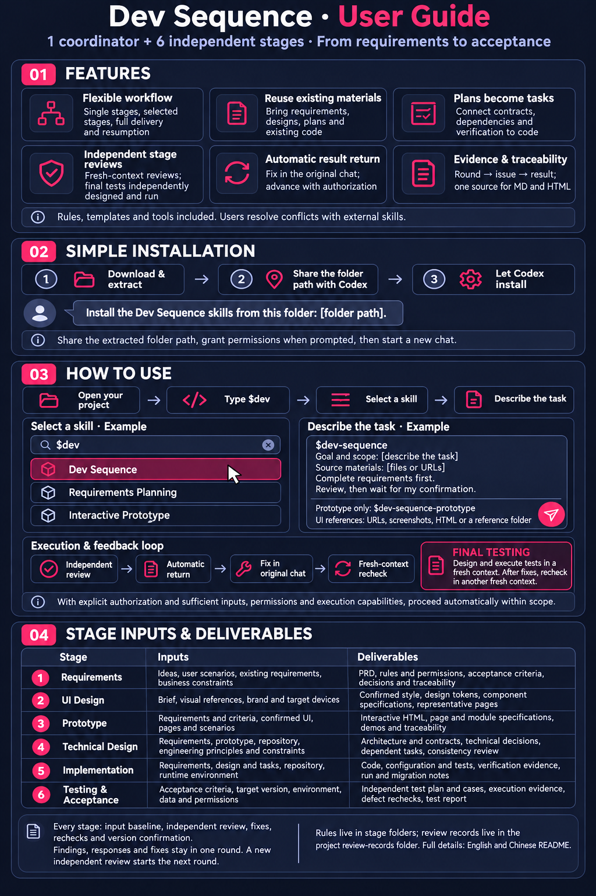

# Dev Sequence · 研序

**A self-contained skill suite for traceable software delivery—from requirements to acceptance.**

English | [简体中文](README.zh-CN.md)

Created and maintained by [@liuyechu-lyc](https://github.com/liuyechu-lyc) · v1.5.0 · [MIT license](LICENSE)

One coordinator and six focused skills let you run a single stage, combine selected stages, or follow the full delivery flow. Every stage defines its inputs, outputs, review criteria, and confirmation gate.

```text
Requirements → UI Design → Interactive Prototype → Technical Design → Implementation → Testing & Acceptance
```



## Features

- **A composable six-stage flow:** one coordinator and six independently callable stages support individual tasks, selected stages, full delivery, and resumption after interruption.
- **Bring the materials you already have:** start with an idea, PRD, design, technical plan, or repository and reuse valid work. UI references accept URLs, attached or pasted screenshots, HTML, and specified folders.
- **Turn plans into implementable tasks:** connect requirements to technical decisions, data/interface contracts, tasks with dependencies and completion criteria, code, verification, and specification convergence checks.
- **Independent acceptance at every stage:** AI reviews use fresh contexts without production history. Final test design, actual execution, and reporting also require a fresh context; fixes are re-verified in another new context. Third-party review includes a complete prompt and input package.
- **Automatic return and authorized progression:** review results return to the original conversation to drive fixes, re-verification, and next steps. Explicit authorization with sufficient goals, inputs, permissions, and host capabilities enables automatic delivery within the agreed scope.
- **Evidence and version traceability:** link requirements, designs, tasks, code, and tests. Review records follow round–issue–result, share a Markdown/HTML source, bind confirmation to a version, and recheck affected conclusions when inputs change.

Rules, templates, the prototype framework, and tools are included. No other development skill or Spec Kit installation is required. External skills can collaborate when useful; conflicting rules and their effects are presented to the user for a decision. Bundled Python tools use only the standard library; project work may still need its own build, test, or browser tools.

## Skills

| Skill | Purpose |
|---|---|
| `$dev-sequence` | Coordinate the full flow or selected stages |
| `$dev-sequence-requirements` | Define scope, business rules, permissions, and acceptance criteria |
| `$dev-sequence-ui` | Confirm visual direction, tokens, and component rules |
| `$dev-sequence-prototype` | Create interactive HTML prototypes and page/module specifications |
| `$dev-sequence-tech` | Design architecture, contracts, decisions, and implementation tasks |
| `$dev-sequence-code` | Implement tasks in the existing repository and record verification |
| `$dev-sequence-test` | Independently design and execute tests in a fresh context, verify fixes, and assess acceptance |

## Installation: ask Codex to handle it

1. **Download and extract** the latest full package from [Releases](https://github.com/liuyechu-lyc/dev-sequence/releases/latest): choose the ZIP without a stage suffix. Repository source downloads also work.
2. **Tell Codex where the extracted folder is**.
3. Send the following chat message, grant the requested permission, then open a new conversation.

```text
Install the Dev Sequence skills from this folder: [extracted folder path].
If an older version exists, check it first and preserve a backup and my customizations.
```

Already installed? Start a new conversation and use the skills. For manual installation and environment requirements, see [detailed installation notes](INSTALL.zh-CN.md).

## Quick start: use the chat input

Open your actual project and start a conversation there. Type **`$dev`** and select **研序 · Dev Sequence** or a specific stage from the skill picker. Describe the goal, source materials, and execution scope in the same message. These are **chat prompts**, not terminal commands.

Start with requirements:

```text
Use $dev-sequence in the current project.

Goal: [describe the users, problem, and intended outcome].
Review existing materials and complete requirements planning only.
Ask about missing critical business rules.
Complete review and wait for my confirmation before continuing.
```

Build a prototype from existing materials:

```text
Use $dev-sequence-prototype.

Requirements: [project-relative file path].
UI references: [URL, screenshots, HTML, or reference folder].
Create and review the interactive prototype only.
For third-party review, provide the complete prompt and input package.
```

Combine stages:

```text
Use $dev-sequence for requirements, UI design, and prototyping only.
Reuse confirmed materials and request my confirmation after each stage.
```

Authorize an automatic flow:

```text
Use $dev-sequence to execute the confirmed scope automatically.
Use a fresh same-model context for independent review and return results here.
Fix and re-verify as needed, then confirm and advance within this authorization.
Ask when critical business inputs, permissions, or rule decisions are missing.
```

UI inputs support URLs, attached or pasted screenshots, HTML files, and a specified project folder. Direction confirmation and final design-specification confirmation are separate steps.

## Review and confirmation

### Read acceptance records by round

After delivering readable artifacts, record the user's explicit choice: same-model review, third-party review, or skip review. General automation authorization does not choose a review method. Reuse a choice across rounds only when explicitly authorized.

Findings, producer responses, and fixes belong to the same round. Append explanations and actual repair evidence under the original finding; repairs do not create separate rounds. The next independent review or re-verification starts a new round. Historical verification records only the issue ID, origin round, outcome, and evidence, and links back to the original record. Verified issues without a new failure are not repeated as later findings. Unresolved items retain compact status links, and omission cannot close a blocker. Affected regression checks still run.

The overview follows stage → round → findings and responses, using the same source as individual Markdown/HTML records. HTML supports collapsible rounds, findings, responses, evidence, and expand/collapse all. Original results remain immutable. Existing round numbers remain intact; stock legacy pages are backed up before upgrading, while custom legacy pages require an explicit template upgrade with backups. See the [record rules](skills/dev-sequence/references/review-layout.md).

### Final acceptance requires independent test design and execution in a fresh context

The final test stage must independently derive or revise its plan/cases from requirements and acceptance criteria, actually execute tests, compare expected and actual results, and produce its report in a new context without production history. Production self-tests, reviewing an existing report, or script-only checks do not replace this requirement.

Results return automatically to the original conversation. The original agent fixes failures and updates the target version; re-verification uses a new round and another fresh context, never a production or historical test context. Passing results require the current identity, design/execution evidence, case IDs, build/environment, and SHA-256-verified evidence files. Missing execution conditions are reported truthfully and returned. Authorized automation preserves the same gate.

```text
Produce → Self-check → Independent review → Fix → Re-verify → Stage confirmation
```

Human stage confirmation is the default. Explicit prior authorization may allow automatic progression, but missing evidence cannot count as a pass.

For **same-model review**, the host creates a fresh context without production history. Completion automatically returns to the original conversation, which validates stage, round, identity, and fingerprints, imports the full result, and performs the appropriate next action.

For **manual third-party review**, the skill still provides a complete prompt and frozen input package for manual handoff.

With explicit automation authorization and sufficient inputs and permissions, stage confirmation and progression can run automatically. Missing critical information, permissions, rule conflicts, or repeated lack of progress require resolution. General development automation does not authorize publishing, paid actions, or external writes. Python persists and validates the handoff; the host agent actually dispatches the reviewer and collects its completion. Missing host capabilities are reported explicitly.

**Implementation complete, convergence complete, tests passed, business acceptance, and release authorization are separate conclusions.**

## Stage inputs and deliverables

Inputs may be chat instructions, project files, URLs, or artifacts from other tools. Earlier skills do not have to run first. Record sources, versions, applicability, and gaps; clarify missing critical business rules. The lists describe the complete delivery scope: tailor, combine, and reuse artifacts as appropriate, while keeping missing required information distinct from genuinely inapplicable items. AC means acceptance criteria; ADR means architecture decision record.

### 1. Requirements planning

Invoke `$dev-sequence-requirements`. Default folder: `需求/`.

**Inputs**

- Product idea, business problem, target users, scenarios, intended outcomes, and supporting evidence.
- Existing requirements, user feedback, business rules, earlier versions, and related materials.
- Scope, priorities, platform, resources, deadlines, dependencies, and known constraints.

**Deliverables**

- `需求.md` (PRD): goals/scope, roles/permissions, business objects/fields, flows/states, normal/error/recovery rules, priorities, and nonfunctional requirements.
- Reproducible AC, business success measures, and stable requirement IDs.
- Open questions, confirmed decisions, assumptions/risks, and a separate change log.
- Initial requirement/rule/AC traceability and business-scope confirmation.

### 2. UI design

Invoke `$dev-sequence-ui`. Default folder: `UI设计/`.

**Inputs**

- Requirements or a design brief covering users, page purpose, functional scope, and information density.
- Visual references: URLs, attached/pasted screenshots, HTML with its dependencies, or a specified project folder.
- Brand guidelines, existing design systems/components, supported devices/sizes, accessibility requirements, and visual constraints.

**Deliverables**

- Reference inventory, adoption/rejection rationale, conflicts, and visual direction; meaningfully different alternatives when the direction is unclear.
- Representative page previews and the first confirmation: visual direction.
- `tokens.css`: colors, typography, spacing, radii, shadows, grid, breakpoints, and density.
- `设计规范.md` and HTML: layout/component rules and applicable default/focus/disabled/loading/error states.
- Specification version, applicability, and the second confirmation: final design specification. Without references, propose a default direction for confirmation first.

### 3. Interactive prototype

Invoke `$dev-sequence-prototype`. Default folder: `原型/`.

**Inputs**

- Requirements/AC or an equivalent business baseline: rules, roles/permissions, flows/states, fields, and validation.
- Confirmed UI specifications or a reusable design system. Layout exploration may start earlier, with visual conclusions pending confirmation.
- Product surfaces, page scope, devices/sizes, demonstration scenarios, and analytics requirements or an explicit no-tracking declaration.

**Deliverables**

- `app/prototype.config.json`: navigation, page registry, overview, versions, and structured traceability.
- Page sources in `app/pages/` and separate page/module/control/flow specifications in `app/specs/`.
- Openable `index.html`, overview, and standalone interactive pages covering primary flows and applicable error/empty/loading/permission/submission states.
- Demo instructions, failure triggers, reset/persistence behavior, mock data, and boundaries of simulated functionality.
- Requirement/AC mappings to pages, modules, and scenarios, plus confirmation of page and interaction scope.

### 4. Technical design

Invoke `$dev-sequence-tech`. Default folder: `技术方案/`.

**Inputs**

- Valid requirements/AC and applicable prototype/UI specifications; declare inapplicable interface scope for projects without a UI.
- Actual repository or target platform, architecture, language/dependency versions, engineering principles, and conventions.
- Data, integration, security, performance, deployment/runtime, resource, and migration constraints.

**Deliverables**

- `技术方案.md` and HTML: architecture, module responsibilities, data flow, failure boundaries, and tradeoffs.
- Targeted research/minimal feasibility checks and ADRs for critical unknowns; data models, lifecycles, and API/event contracts.
- Risk-appropriate authorization, recovery, transaction/idempotency/concurrency, observability, deployment/migration/rollback, and verification guidance.
- `tasks.json` with Markdown/HTML views: task IDs, requirement sources, files/artifacts, dependencies, completion criteria, and verification methods.
- Requirements–prototype–design–contract–task consistency analysis, risks, and technical-design confirmation.

### 5. Implementation

Invoke `$dev-sequence-code`. New projects without an existing layout put implementation files in `代码/`. Existing repositories keep their source layout and use `代码/` for implementation records.

**Inputs**

- Confirmed requirements/AC, applicable prototype/UI, technical design, ADRs, contracts, and tasks.
- Actual repository, existing uncommitted changes, engineering conventions, configuration, dependencies, and existing tests.
- Change scope, verification methods, permissions, and environment constraints. A brief baseline may combine design and task descriptions for a small fix.

**Deliverables**

- Business code, configuration, applicable migration scripts, and tests appropriate to the change's risk.
- Task status and implementation/verification evidence, linking requirements/AC to tasks, code, and tests.
- Actual build, static-check, and applicable test results, distinguishing mocks from real integrations.
- Design deviations, associated ADRs, updates to authoritative plans, and run/configuration/deployment/migration notes.
- Specification convergence findings, remaining repair tasks, implementation version/scope/limitations, and confirmation.

### 6. Testing and acceptance

Invoke `$dev-sequence-test`. Default business-test-artifact folder: `测试验收/`.

**Inputs**

- Current requirements/AC, applicable UI/prototype, technical design/contracts, tasks, change scope, and risks.
- An identified code/build/configuration version, usable environment, data, accounts, and execution permissions.
- Existing cases, developer self-tests, known defects, and prior evidence as references. The original conversation supplies the frozen baseline and identity; a final test report is not a prerequisite.

**Deliverables — independently produced in a fresh test context**

- A test plan and TC cases independently derived or revised from requirements, with AC coverage.
- Actual execution results: preconditions, steps, expected/actual outcomes, logs/screenshots and other evidence; build, environment, context identity, and design/execution evidence-file fingerprints.
- Stable DF defect records, followed by re-verification and affected regression in another new context after fixes.
- Specification convergence findings, unexecuted items, limitations/risks, `测试报告.md` and HTML, delivery recommendation, and confirmation.
- Automatic return of the round's result to the original conversation for fixes or authorized progression. Test success, business acceptance, and release authorization remain separate decisions.

### Shared deliverables

- **Input/delivery baseline:** goals/exclusions, sources/versions, facts/assumptions/open decisions, current artifacts, traceability, and real self-check results. Use `输入基线.md` to map external materials to equivalent input roles.
- **Acceptance rules:** `.review-skill.md` and `验收规则.html` at each stage root.
- **Acceptance records:** requests, frozen inputs, complete third-party prompts when selected, and round-specific issues/fixes/re-verification/results in project-level `验收记录/`; formal Markdown/HTML share a source.
- **Handoff and confirmation:** internal authorization history and handoff ledgers in .dev-sequence/reviews/; per-round returned results and evidence in the stage record directory’s .过程/ folder, with version-bound confirmation.
- **Project collaboration:** create and maintain `项目理解.md`, `交互记录.md`, and applicable `工程原则.md` as needed.

Business test plans and reports belong in `测试验收/`; acceptance-round records remain in `验收记录/`. See the [concise guide in Chinese](docs/usage-guide.zh-CN.md).

## File locations

- Acceptance **rules**: each stage root, as `.review-skill.md` and `验收规则.html`.
- Acceptance **records, requests, third-party prompts, and round reports**: the project-level `验收记录/` directory.
- Review records follow **round → issue → result**, with matching Markdown and HTML.
- For a final delivery after the applicable stages have passed and been accepted, use the [final delivery rules](skills/dev-sequence/references/final-delivery.md) to package reviewed files.

Default stage folders are `需求/`, `UI设计/`, `原型/`, `技术方案/`, `代码/` (implementation records), and `测试验收/`.

## Documentation and validation

- [Usage and handoff examples](examples/usage.md)
- [Review protocol and CLI reference](skills/dev-sequence/references/review-protocol.md)
- [External skill collaboration](skills/dev-sequence/references/external-skills.md)
- [Validation notes](docs/validation.md)
- [Three-round acceptance example](examples/acceptance-rounds.md)
- [Complete user guide in Chinese](docs/usage-guide.zh-CN.md)
- [Automatic handoff and authorized execution](skills/dev-sequence/references/automatic-handoff.md)
- [English guide image](docs/assets/dev-sequence-guide.en-v1.png)

Validate bundle structure:

```sh
python3 tools/validate_bundle.py
```

Run regressions from the **full source package**:

```sh
PYTHONDONTWRITEBYTECODE=1 PYTHONPATH=skills/dev-sequence/scripts python3 -m unittest discover -s tests -v
```

Version 1.5.0 ships prototype framework 3.14.1 with module-level annotation guidance, fixed-size markers, and visible-canvas positioning. It adds a final delivery tool that packages allowlisted files after review and verifies them against frozen test inputs. The seven requirement and prototype review gates introduced in v1.4.1 remain in the workflow. See [validation](docs/validation.md) and the [changelog](CHANGELOG.md) for details.

## Project structure and contributions

```text
skills/       Coordinator, six stages, rules, templates, and runtime tools
docs/         Usage guide, images, and repository description
examples/     Invocation and handoff examples
tools/        Installation, packaging, and bundle validation
tests/        Behavioral regressions
.github/      CI and issue/PR templates
```

Report real-project findings through [Issues](https://github.com/liuyechu-lyc/dev-sequence/issues), or follow [CONTRIBUTING.md](CONTRIBUTING.md) to propose a change. See [SECURITY.md](SECURITY.md) for vulnerability reporting.

Free and open source under the [MIT license](LICENSE). Preserve the copyright and license notices when using or distributing the project. Author: [liuyechu-lyc](https://github.com/liuyechu-lyc).
