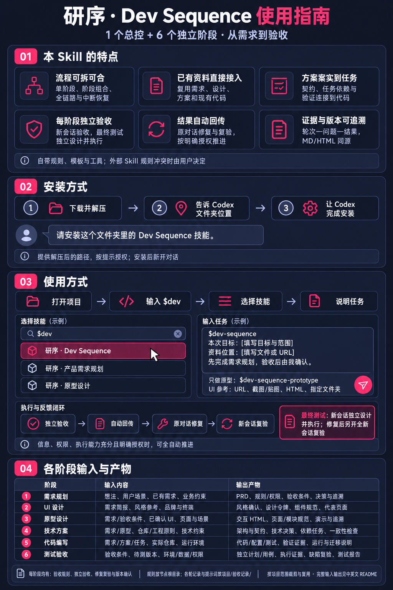

# 研序 · Dev Sequence

**从需求到验收，让研发交付有规则、有追溯、有证据。**

[English](README.md) | 简体中文

由 [@liuyechu-lyc](https://github.com/liuyechu-lyc) 创建与维护 · v1.5.0 · [MIT 开源许可](LICENSE)

Dev Sequence 是一套独立的从产品到研发交付 skill 工具包，由 **1 个总控＋6 个流程 skill** 组成。支持单环节运行、阶段组合、全链路交付及中断恢复，每个阶段都有明确的输入、输出、验收标准和确认环节。

```text
产品需求规划 → UI设计 → 交互原型 → 技术方案设计 → 代码编写 → 测试验收
```



## 本 skill 的特点

- **流程可拆可合。** 1 个总控编排 6 个独立阶段，可只做一个环节、组合几个环节，也可贯穿全链路，并从中断处恢复。
- **已有资料直接接入。** 从想法、PRD、设计稿、技术方案或现有仓库开始，复用有效成果；UI 参考支持 URL、截图/贴图、HTML 和指定文件夹。
- **方案落实到实施任务。** 将需求转成技术决策、数据与接口契约、带依赖和完成条件的任务，再落实到代码、验证和规格收敛检查。
- **每个阶段独立验收。** AI 验收使用不继承生产历史的新会话；最终测试的用例设计、实际执行和报告也必须在新会话完成，修复后再开全新会话复验。第三方验收提供完整提示词和资料。
- **结果自动回传，授权后持续推进。** 验收结果自动交回原对话，驱动修复、复验和下一步；目标、信息、权限及执行能力充分且用户明确授权时，支持范围内全自动交付。
- **过程有证据，变更可追溯。** 串联需求、设计、任务、代码与测试；验收按“轮次—问题—结果”记录，MD/HTML 同源，确认绑定版本，输入变化后重新检查受影响结论。

工具包自带规则、模板、原型框架及工具，不要求安装其他研发 skill 或 Spec Kit。可按需配合外部 skill；规则冲突时列明来源与影响，由使用者决定。配套 Python 工具仅使用标准库；真实项目的构建、测试或浏览器操作可能需要项目自身工具。

## 包含哪些 skill

| 调用名称 | 用途 |
|---|---|
| `$dev-sequence` | 总控，编排全流程或所选阶段 |
| `$dev-sequence-requirements` | 产品需求规划：范围、业务规则、权限与验收条件 |
| `$dev-sequence-ui` | UI设计：风格方向、设计令牌、组件与布局规范 |
| `$dev-sequence-prototype` | 原型设计：可交互 HTML、页面/模块规范与需求覆盖 |
| `$dev-sequence-tech` | 技术方案：架构、数据/接口契约、决策和实施任务 |
| `$dev-sequence-code` | 代码编写：按任务实施、验证并记录设计偏离 |
| `$dev-sequence-test` | 测试验收：在新会话独立设计并执行测试、缺陷复验与交付判断 |

## 安装：让 Codex 帮你完成

1. 在 [Releases 下载最新版完整安装包](https://github.com/liuyechu-lyc/dev-sequence/releases/latest)，选择不带阶段后缀的 ZIP 并**解压**；也可下载仓库源码。
2. **把解压后的文件夹位置告诉 Codex**。
3. 在聊天输入框发送下面这句话，按提示授权，安装后新开对话。

```text
请安装这个文件夹里的 Dev Sequence 技能。
文件夹位置：[填写你解压后的文件夹路径]。
如有旧版本，请先检查并保留备份，不覆盖我的自定义内容。
```

已经安装的用户可直接在新对话中使用。需要自行操作或查看环境要求时，见[详细安装说明](INSTALL.zh-CN.md)。

## 在输入框中怎么用

**打开真实项目 → 在项目中开始对话 → 输入 `$dev` → 选择技能 → 描述任务。**

技能列表中，选择“研序 · Dev Sequence”可编排流程；只做一个环节时，选择相应的“研序 · 产品需求规划”“研序 · 原型设计”等。然后在同一条消息中说明目标、资料位置和执行范围。

以下示例直接粘贴到**聊天输入框**，不是终端命令。

**第一次使用：先做需求规划。**

```text
使用 $dev-sequence，在当前项目中开展研发交付。

本次需求：[填写目标用户、业务问题和希望实现的结果]。

先检查项目现有资料，只完成产品需求规划。
缺少的关键业务信息向我集中询问。
需求成果完成验收并经我确认后，再进入下一阶段。
```

**已有需求：只做原型。**

```text
使用 $dev-sequence-prototype。

需求文档：[填写项目内文件路径]。
UI参考：[填写URL、截图、HTML文件或参考文件夹]。

只完成交互原型及验收，不进入代码编写。
如选择第三方Agent验收，请输出完整提示词和资料入口。
```

**只做选定的几个阶段。**

```text
使用 $dev-sequence，本轮只完成需求规划、UI设计和原型设计。
复用已有且有效的成果，每个阶段验收后由我确认。
```

**明确授权全自动：**

```text
使用 $dev-sequence，在当前项目按已确认范围全自动执行。
由本模型在新上下文独立验收，完成后自动回传原对话。
原对话根据结果自动修复、复验并继续；通过后按本次授权确认阶段。
遇到关键业务信息缺失、权限不足或规则冲突时再向我说明。
```

UI 设计支持 URL、截图/粘贴图片、HTML 文件和项目指定参考文件夹。先确认风格方向，再确认最终设计规范版本。

## 如何验收与自动执行

### 按轮次阅读验收记录

成果可阅读后，明确选择「本模型自动验收 / 第三方验收 / 暂不验收」；全自动开发授权不替代验收方式选择。只有明确授权复用时才沿用后续轮次的选择。

发现、答复和修复归属同一轮：主对话在问题下追加答复、修复说明与证据，不另建修复轮次。下一次独立验收或复验才新建轮次。旧问题复验简要记录编号、来源轮次、结果和证据，并关联回原轮次；已验证关闭且未再发现异常的项不重复列入后续问题清单。未关闭项保留编号、状态和入口，省略不能视为关闭；回归检查仍按实际影响执行。

总览按「阶段 → 轮次 → 问题与答复」组织，与单轮MD/HTML同源。HTML支持轮次、问题、答复及证据折叠和全部展开/收起。原始结论冻结，后续处理追加。已有项目保留旧轮次编号；默认旧模板刷新前自动备份，定制旧页面需明确升级并保留备份。具体命令见[验收记录规则](skills/dev-sequence/references/review-layout.md)。

### 最终测试验收：必须新会话独立设计与执行

最终测试节点必须在不继承生产历史的新会话中，从需求和AC独立形成或修订测试计划/TC，实际执行、核对预期与实际结果并生成报告。原会话自测、只让新会话审阅旧报告或仅运行脚本，都不能替代最终独立测试。

结果自动回传原会话；未通过由原会话修复并更新待测版本，再创建新轮次、另开全新会话复验及受影响回归，不能复用生产或历史测试会话。通过结果须有本轮身份、设计/执行证据、TC、构建/环境，以及真实证据文件的SHA-256。缺条件如实未检查并回传，不能冒充通过；全自动模式同样遵守。

```text
形成产物 → 自检 → 独立评审 → 修复 → 复验 → 阶段确认
```

默认每阶段由使用者确认后推进；明确预授权可用于自动推进，但不能把缺证据、未检查改成通过。

选择**本模型验收**：由宿主创建不继承生产历史的新上下文，验收完成后自动回传原对话。原对话核对阶段、轮次、身份和内容指纹，导入完整结果，并实际执行修复、补证、复验或下一阶段。

选择**第三方手动验收**：仍输出完整提示词和冻结资料，由使用者交接并返回结果。

明确要求全自动且信息、权限齐备时，按有效授权自动确认和推进。规则冲突、关键输入缺失、权限不足或重复无进展时，处理具体阻塞；不把泛称全自动扩展成发布、付费或外部写入授权。Python负责持久化和校验，宿主Agent实际创建隔离上下文与收取通知；缺少能力时明确报告。

**代码完成、规格收敛、测试通过、业务接受和允许发布分别记录，不互相替代。**

## 各阶段输入内容与输出产物

输入可以是当前对话中的说明，也可以是项目文件、URL 或其他工具产物，不要求先运行上游 skill。接入时记录来源、版本、适用范围与缺失项；关键业务规则缺失时集中澄清。以下按完整交付列出，实际按项目范围裁剪、合并和复用；必需资料缺失不能标为“不适用”。AC 指可执行验收条件，ADR 指技术决策记录。

### 1. 产品需求规划

调用：`$dev-sequence-requirements`；默认目录：`需求/`。

**输入内容**

- 产品想法、业务问题、目标用户、使用场景、预期结果及问题证据。
- 已有需求、用户反馈、业务规则、历史版本和相关资料。
- 范围、优先级、平台、资源、时限、依赖及已知约束。

**输出产物**

- `需求.md`：目标与范围、角色权限、业务对象与字段、流程与状态、正常/异常/恢复规则、优先级及非功能要求。
- 可复现的 AC、业务成功指标及需求稳定编号。
- 待澄清事项、已确认决策、假设/风险和独立变更记录。
- 需求与规则/AC 的初始追溯，以及业务范围确认。

### 2. UI设计

调用：`$dev-sequence-ui`；默认目录：`UI设计/`。

**输入内容**

- 需求文档或设计简报：目标用户、页面用途、功能范围和信息密度。
- 风格参考：URL、截图/粘贴图片、HTML 及其依赖，或项目内指定参考文件夹。
- 品牌规范、既有设计系统/组件库、支持终端与尺寸、无障碍及其他视觉约束。

**输出产物**

- 参考来源清单、采纳/舍弃依据、冲突说明和风格方向；方向不明确时提供有实质差异的方案。
- 代表性页面预览及第一次“风格方向确认”。
- `tokens.css`：颜色、字体、间距、圆角、阴影、网格、断点和密度等设计令牌。
- `设计规范.md` 及 HTML：布局、组件及默认/聚焦/禁用/加载/错误等状态规范。
- 规范版本、适用范围与第二次“最终规范确认”。无参考时先提出默认方向供确认。

### 3. 原型设计

调用：`$dev-sequence-prototype`；默认目录：`原型/`。

**输入内容**

- 需求/AC 或等价业务基线：业务规则、角色权限、流程状态、字段与校验。
- 已确认 UI 规范或可复用设计系统；尚未确认时可先探索布局，视觉结论待确认。
- 业务端、页面范围、支持终端/尺寸、演示场景，以及埋点要求或无需埋点的声明。

**输出产物**

- `app/prototype.config.json`：导航、页面注册、概述、版本及结构化追溯。
- `app/pages/` 页面源文件和 `app/specs/` 独立页面/模块/控件/流程规范。
- 可打开的 `index.html`、概述及独立交互页面，覆盖主流程与适用的异常、空、加载、权限和提交状态。
- 演示方法、失败触发、重置与状态保留说明、模拟数据和真实能力边界。
- 需求/AC 与页面、模块及演示场景的映射，页面与交互范围确认。

### 4. 技术方案设计

调用：`$dev-sequence-tech`；默认目录：`技术方案/`。

**输入内容**

- 有效需求/AC、适用的原型与 UI 规范；无界面项目说明其不适用范围。
- 实际仓库或目标平台、现有架构、语言/依赖版本、工程原则和项目约定。
- 数据、外部集成、安全、性能、部署运行、资源和迁移等约束。

**输出产物**

- `技术方案.md` 及 HTML：架构、模块职责、数据流、故障边界和工程取舍。
- 针对关键未知项的研究/最小验证及 ADR；数据模型、生命周期、接口/事件契约。
- 按风险设计的权限、错误恢复、事务/幂等/并发、可观测性、部署/迁移/回退与验证说明。
- `tasks.json` 及 MD/HTML 任务视图：任务编号、关联要求、文件/产物、依赖、完成条件和验证方法。
- 需求—原型—方案—契约—任务一致性检查、风险清单及方案确认。

### 5. 代码编写

调用 `$dev-sequence-code`。新项目没有既有工程布局时，将实施文件集中在 `代码/`。已有工程沿用现有源码布局，实施记录放在 `代码/`。

**输入内容**

- 已确认需求/AC、适用原型/UI、技术方案、ADR、契约和任务清单。
- 实际仓库、已有未提交改动、工程规范、运行配置、依赖和现有测试。
- 本轮修改范围、验证方式及权限/环境约束；小修复可用简短基线合并说明设计与任务。

**输出产物**

- 实际仓库中的业务代码、配置、按需迁移脚本及适合本次风险的测试。
- 任务状态与实施/验证证据，以及需求/AC 到任务、实现和测试的关联。
- 真实构建、静态检查及适用测试结果，区分模拟与真实集成。
- 设计偏离、相关 ADR 和权威方案回写；运行、配置、部署/迁移说明。
- 规格收敛检查、剩余修复任务、实现版本/范围/已知限制及实施确认。

### 6. 测试验收

调用：`$dev-sequence-test`；业务测试产物默认目录：`测试验收/`。

**输入内容**

- 当前有效需求/AC、适用 UI/原型、技术方案/契约、任务、变更范围与风险。
- 明确的待测代码/构建/配置版本、可用环境、数据、账号及执行权限。
- 已有用例、开发自测、已知缺陷和历史证据作为参考；原会话提供冻结基线与身份，不必先产出最终测试报告。

**输出产物——必须由新测试会话独立完成**

- 从需求独立形成或修订的测试计划、TC 用例和 AC 覆盖关系。
- 实际执行结果：前置条件、步骤、预期/实际、日志/截图等真实证据；记录构建、环境、会话身份及设计/执行证据文件指纹。
- 稳定编号的 DF 缺陷、修复后另开全新会话完成的复验及受影响回归。
- 规格收敛检查、未执行项目、限制/风险，以及 `测试报告.md` 和 HTML、交付建议与确认。
- 自动回传原会话的本轮结果，供原会话修复或按有效授权推进。测试通过、业务接受和发布许可分别记录。

### 各阶段共同产物

- **输入与交付基线**：目标/排除范围、来源与版本、事实/假设/待决项、当前产物、追溯和真实自检。接入外部资料时用 `输入基线.md` 说明等价角色。
- **验收规则**：各节点根目录的 `.review-skill.md` 和 `验收规则.html`。
- **验收记录**：项目根 `验收记录/` 内的请求、冻结资料、完整第三方提示词（选择第三方时）、各轮问题/修复/复验和结果；正式 MD/HTML 同源。
- **交接与确认**：内部授权历史与交接账本放在隐藏目录.dev-sequence/reviews/；本轮回传和证据放在验收阶段目录的.过程/。阶段确认绑定版本和真实依据。
- **项目级协作资料**：按需建立并维护 `项目理解.md`、`交互记录.md` 和适用的 `工程原则.md`。

业务测试计划与报告放在 `测试验收/`；各轮验收记录仍统一放在 `验收记录/`。简明总览见[完整使用指南](docs/usage-guide.zh-CN.md)。

## 项目中的文件位置

- **验收规则**：各流程节点根目录中的 `.review-skill.md` 和 `验收规则.html`。
- **验收记录、请求、第三方提示词和各轮报告**：统一放项目根目录下的 `验收记录/`。
- 验收记录按 **轮次 → 问题 → 结果** 组织，正式文档提供同源 MD 和 HTML。
- 实际源码保持仓库原位置，不因文档结构迁移。

默认节点目录为 `需求/`、`UI设计/`、`原型/`、`技术方案/`、`代码/`（实施记录）和 `测试验收/`。

## 文档和验证

- [更多调用与交接示例](examples/usage.md)
- [验收协议与命令](skills/dev-sequence/references/review-protocol.md)
- [外部 skill 协作规则](skills/dev-sequence/references/external-skills.md)
- [精简验证说明](docs/validation.md)
- [三轮验收流程示例](examples/acceptance-rounds.md)
- [完整使用指南](docs/usage-guide.zh-CN.md)
- [自动交接与全自动执行](skills/dev-sequence/references/automatic-handoff.md)
- [使用指南图片](docs/assets/dev-sequence-guide.zh-CN-v4.png)

检查包结构：

```sh
python3 tools/validate_bundle.py
```

在**完整源码包**内运行行为回归：

```sh
PYTHONDONTWRITEBYTECODE=1 PYTHONPATH=skills/dev-sequence/scripts python3 -m unittest discover -s tests -v
```

v1.5.0 纳入原型框架 3.14.1，明确多模块标注、圆点尺寸和可视区域内收规则，并新增最终交付工具。工具按白名单从最终测试冻结输入中核对文件，确认适用阶段通过并接受后生成交付目录。需求和原型沿用 v1.4.1 的七类必检闸门。参见[最终交付规则](skills/dev-sequence/references/final-delivery.md)、[验证说明](docs/validation.md)和[变更记录](CHANGELOG.md)。

## 项目结构与参与贡献

```text
skills/       总控、六个阶段及配套规则/模板/工具
docs/         使用指南、图片与仓库简述
examples/     调用与交接示例
tools/        安装、打包和套件校验
tests/        行为回归
.github/      自动检查及 issue/PR 模板
```

欢迎通过 [Issues](https://github.com/liuyechu-lyc/dev-sequence/issues) 反馈真实项目试用问题，或按[贡献说明](CONTRIBUTING.md)提交改进。安全问题见[反馈方式](SECURITY.md)。

项目按 [MIT 许可](LICENSE)免费开源，使用和分发时保留版权与许可声明。作者：[liuyechu-lyc](https://github.com/liuyechu-lyc)。
