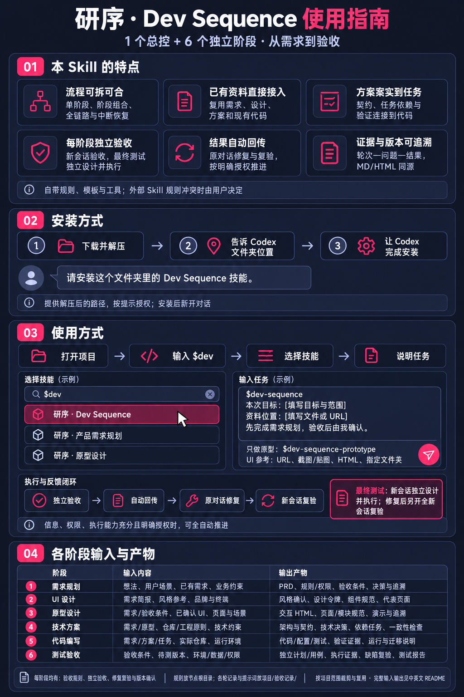

# 研序 · Dev Sequence 使用指南



## 1. 本 skill 的特点

- **流程可拆可合**：1 个总控＋6 个独立阶段，支持单环节、阶段组合、全链路及中断恢复。
- **已有资料直接接入**：想法、PRD、设计稿、方案和仓库均可接入；UI 支持 URL、截图/贴图、HTML、指定参考文件夹。
- **方案落实到实施任务**：技术决策、数据/接口契约、任务依赖与完成条件连接到代码、验证和规格收敛检查。
- **每个阶段独立验收**：AI 验收使用新会话；最终测试设计、执行与报告必须整体在新会话完成，修复后再开全新会话复验；第三方验收有完整提示词和资料。
- **结果自动回传，授权后持续推进**：原对话接收结果并修复、复验；目标、信息、权限和执行能力充分且明确授权时，按范围自动确认和推进。
- **过程有证据，变更可追溯**：需求到测试相互关联，验收按轮次—问题—结果记录，MD/HTML 同源、确认绑定版本，输入变化后重查受影响结论。

工具包自带规则、模板、原型框架与工具，不要求安装其他研发 skill。可按需协作外部 skill；规则冲突时列明来源与影响，由使用者决定。

## 2. 安装方式

1. 从 [Releases 下载完整安装包](https://github.com/liuyechu-lyc/dev-sequence/releases/latest)，选择不带阶段后缀的 ZIP 并**解压**；也可下载仓库源码。
2. **告诉 Codex 文件夹位置**。
3. 发送下面这句话，按提示授权，安装后新开对话。

```text
请安装这个文件夹里的 Dev Sequence 技能。
文件夹位置：[填写解压后的文件夹路径]。
如有旧版本，请检查后保留备份，不覆盖我的自定义内容。
```

已安装的用户可直接新开对话使用。需要手动操作或查看环境要求时，见[详细安装说明](../INSTALL.zh-CN.md)。

## 3. 使用方式

**打开真实项目 → 开始对话 → 输入 `$dev` → 选择技能 → 说明目标、资料和范围。**

全流程或阶段组合选择“研序 · Dev Sequence”；单环节选择对应技能。以下内容直接输入聊天框。

### 先做需求，逐阶段确认

```text
使用 $dev-sequence。
本次目标：[填写用户、问题和预期结果]。
先完成产品需求规划，由本模型在新上下文验收后自动回传。
原对话根据结果修正和复验，阶段通过后由我确认。
```

### 已有需求，只做原型

```text
使用 $dev-sequence-prototype。
需求文档：[填写项目内路径]。
UI参考：[填写URL、截图、HTML或参考文件夹]。
只完成原型及验收，不进入代码编写。
```

### 明确授权全自动

```text
使用 $dev-sequence，在当前项目按已确认范围全自动执行。
由本模型在新上下文独立验收，完成后自动回传原对话。
原对话根据结果自动修复、复验并继续；通过后按本次授权确认阶段。
遇到关键业务信息缺失、权限不足或规则冲突时再向我说明。
```

| 工作 | 调用名称 |
|---|---|
| 总控或组合 | `$dev-sequence` |
| 产品需求规划 | `$dev-sequence-requirements` |
| UI设计 | `$dev-sequence-ui` |
| 原型设计 | `$dev-sequence-prototype` |
| 技术方案设计 | `$dev-sequence-tech` |
| 代码编写 | `$dev-sequence-code` |
| 测试验收 | `$dev-sequence-test` |

先选择本模型自动验收、第三方验收或暂不验收；没有明确选择不派发。默认保留阶段确认。明确授权全自动后，沿用有效授权，不机械要求反复发送“继续”。第三方手动验收仍提供完整提示词和冻结资料。

本模型的自动回传由宿主独立评审上下文实现；原对话保持执行/等待直到结果。没有相应能力时会明确说明，不在同一生产对话中假装独立验收。部署、发布、付费和外部写入需要相应授权，不能从“全自动开发”推断。

## 4. 各阶段输入内容与输出产物

不必先跑完上游阶段。已有文件、当前对话说明和外部工具成果可作为等价输入，登记来源与版本；关键规则缺失时先澄清。下表是完整范围总览，实际按项目适用性裁剪与复用。AC 为可执行验收条件，ADR 为技术决策记录。

| 阶段（默认目录） | 输入内容 | 输出产物 |
|---|---|---|
| 产品需求规划（`需求/`） | 想法与业务问题、用户/场景/目标、问题证据；已有需求/反馈/规则；范围、优先级、资源、平台、时限和依赖 | `需求.md`：范围、角色权限、字段、流程状态、异常恢复、AC及非功能要求；澄清/决策/假设/风险、变更记录、初始追溯与范围确认 |
| UI设计（`UI设计/`） | 需求或简报、用户/页面用途/终端；URL、截图/贴图、HTML及依赖、指定文件夹；品牌/设计系统/组件库和视觉约束 | 参考采纳清单、风格方向与首次确认；`tokens.css`；设计规范MD/HTML、布局/组件状态、代表性页面；规范版本与最终确认 |
| 原型设计（`原型/`） | 需求/AC、规则、权限、字段/校验、流程状态；已确认UI或设计系统；业务端/页面/终端/场景及埋点要求 | `app/`注册表、页面源与独立规范；`index.html`及交互页面；主流程/异常/权限/提交等状态；演示、失败触发、重置/保留与模拟边界；需求追溯与交互确认 |
| 技术方案设计（`技术方案/`） | 需求/AC、适用原型/UI；实际仓库/平台、架构/依赖版本/工程原则；数据、集成、安全、性能和运行资源约束 | 技术方案MD/HTML、研究/ADR、架构/模型/接口契约、适用恢复/迁移/回退设计；`tasks.json`及任务视图、运行验证说明、一致性检查和方案确认 |
| 代码编写（新项目实施文件集中 `代码/`，已有工程沿用源码布局） | 需求/AC、适用原型/UI、技术方案/ADR/契约/任务；仓库及已有改动、环境/配置/规范/现有测试；范围与权限 | 代码/配置/适用迁移与测试；任务状态和实施/验证证据；构建/检查/测试结果、设计偏离及方案回写、运行/迁移说明；收敛差距和实施版本确认 |
| 测试验收（业务产物`测试验收/`） | 需求/AC、适用设计/契约/任务、变更/风险；明确待测版本、环境、数据/账号/权限；已有用例/自测/缺陷作参考 | **新会话独立设计并执行**的计划/TC及AC覆盖；预期/实际与真实证据、构建/环境/身份和证据指纹；DF缺陷、修复后全新会话复验/回归；收敛结果、测试报告MD/HTML、限制和交付建议；结果自动回传 |

逐阶段的完整清单见[中文说明](../README.zh-CN.md#各阶段输入内容与输出产物)。无参考的 UI 先提出方向供确认；最终测试不要求原会话先提供最终报告。

### 各环节共同产物

- **输入与交付基线**：目标/排除范围、来源/版本、事实/假设/待决项、当前产物、追溯和真实自检；外部资料用`输入基线.md`说明等价角色。
- **验收规则**：各节点根目录`.review-skill.md`与`验收规则.html`。
- **验收明细**：项目根`验收记录/`内的请求、提示词、轮次报告、汇总和冻结资料。
- **交接记录**：内部授权与交接账本保存在隐藏目录.dev-sequence/reviews/；各轮回传、快照与证据放在所属验收阶段目录的.过程/。
- **记录结构**：阶段→轮次→问题/答复/结果；发现、答复和修复同轮，下一次独立复验才增轮次。复验简要关联旧问题，已验证关闭且无新异常的项不重复列出，未关闭项保留状态入口。MD/HTML同源，原始结果冻结；HTML支持轮次、问题、答复折叠和全部展开/收起。
- **阶段确认**：绑定范围、版本、验收轮次和真实确认依据；授权自动确认时记录预授权来源。
- **项目协作资料**：按需维护`项目理解.md`、`交互记录.md`及适用的`工程原则.md`。

业务测试计划与报告放在`测试验收/`，各轮验收记录统一放在`验收记录/`。按实际项目范围生成产物，复用有效成果，无UI任务不强造界面。代码完成、规格收敛、测试通过、业务接受和发布许可分别记录。

## 最终测试验收强制新会话

最终测试必须在新会话独立设计并实际执行，不只是审阅原会话报告。结果自动回传原会话修复，更新待测版本后另开全新会话复验；不能复用生产或历史测试上下文。通过需本轮身份、TC、设计/执行证据、构建/环境及证据文件指纹。缺隔离或执行条件时真实标未检查并回传；全自动也不能跳过。
