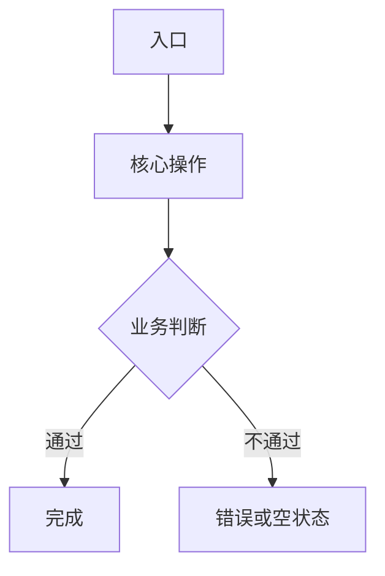

# 原型规格说明：[产品/功能名称]

> 原型业务版本：v0.1｜日期：YYYY-MM-DD｜关联 PRD：需求/需求.md｜PRD 版本：v0.1

> 业务版本和追溯的维护源是 `app/prototype.config.json`。这里的元信息由配置引用或生成；保留既有 US/FR/PG/FL/FD/AC 编号。

## 1. 原型范围

### 1.1 用户流程



### 1.2 页面清单

| 端 | 页面 | 功能描述 | 支持终端 | 本次变更 |
|---|---|---|---|---|
| 管理端 | [页面名] | [页面长期职责] | PC | [新增/修改内容；无则写本版本无修改] |
| 骑手端 | [页面名] | [页面长期职责] | 手机 | [新增/修改内容；无则写本版本无修改] |

> 页面清单从项目注册表引用或生成；项目概述按业务端展示“页面 + 页面功能描述 + 本版本修改内容”三列，长期职责与本次变化分开。

## 2. 页面声明

新项目在配置顶层声明 `contentStandardVersion: 1`，在 `project.version` 声明原型业务版本，在 `project.prd` 绑定相对 app 的 PRD 路径及版本。每个页面声明终端、规范路径和变更状态；Manifest 由构建器生成（业务绑定也由构建器写入，不手工维护）：

```json
{
  "channel": "dev-sequence-prototype",
  "protocolVersion": 5,
  "frameworkVersion": "3.14.1",
  "specSchemaVersion": 5,
  "pageId": "stable-page-id",
  "title": "页面名称",
  "viewports": {
    "default": "pc",
    "supported": [
      { "type": "pc", "width": 1440, "height": 900 }
    ]
  },
  "specsEnabled": true
}
```

- 终端只允许 `pc`、`tablet`、`mobile`；单终端也必须声明。
- 页面允许声明 `"specs": { "enabled": false }`，Index 此时隐藏技术规范区。
- 项目概述是普通页面，同样遵循以上声明。
- 控件说明页使用 `kind: "component-guide"`，不声明技术规范；完整标准见 `CORE_ROOT/references/prototype-component-guide-standard.md`。

## 3. 页面级技术规范

页面打开后默认展示。按实际需要填写“标题 + 内容”，不固定分类；按适用性说明角色/任务、入口条件、数据范围/排序/分页、离开/未保存处理和恢复，业务规则引用 PRD 的 FR/BR/AC：

```json
"page": {
  "title": "页面技术规范",
  "sections": [
    { "key": "overview", "title": "概述", "content": "[页面职责]", "changeType": "existing" },
    {
      "key": "changes",
      "title": "修改点",
      "items": [
        { "text": "[本次修改内容]", "changeType": "modified" }
      ]
    },
    { "key": "logic", "title": "核心逻辑", "content": "[页面级业务规则]", "changeType": "existing" }
  ]
}
```

## 4. 模块级技术规范与标注

模块规范同时是标注点数据源，禁止另建 marker 数组。每个模块必须包含一份结构化的“内容与控件说明”，覆盖模块内全部可见内容：

```json
{
  "key": "search-module",
  "title": "搜索模块",
  "layer": "base",
  "changeType": "modified",
  "changeImpact": "interaction",
  "sections": [
    { "key": "overview", "title": "概述", "content": "[模块职责]", "changeType": "existing" },
    {
      "key": "controls",
      "title": "内容与控件说明",
      "type": "controls",
      "items": [
        {
          "name": "站点名称",
          "controlType": "单选",
          "dataSource": "配送站点接口",
          "defaultValue": "当前账号所属站点",
          "required": true,
          "options": "接口返回的可用站点",
          "constraints": "仅允许选择一个站点",
          "changeType": "modified"
        }
      ]
    }
  ]
}
```

- `layer` 为 `base` 或 `modal`；浮层、弹窗、抽屉内模块使用 `modal`。该值只表达语义，不保存数字 z-index 或嵌套深度。
- 每个承载标注或阻断下层操作的载体根节点声明 `data-ds-overlay-root`。公共运行时按可见 DOM 嵌套自动形成“基础页—基础标注—一级载体—一级标注—二级载体—二级标注”的连续层级。
- 载体默认阻断下层标注；仅明确允许与下层同时操作的非模态浮层声明 `data-ds-overlay-mode="nonmodal"`。关闭载体后，下层标注必须自动恢复。
- `changeType` 为 `new`、`modified`、`existing`，可下沉到 `1.1.3` 级条目。
- 文本、标签和只读字段必须写明数据源；单行/多行文本必须写明默认值、是否必填、长度与内容限制。
- 单选、多选、单选组、多选组必须写明默认勾选、是否必选及固定或外部选项来源；Tab 必须写明默认选中。
- 日期、时间、日期段和时间段必须写明默认值与可选范围。
- 保存/提交按钮使用 `buttonRole: "save-submit"`：`validationRules` 为校验规则，`failureResult` 为校验失败反馈，`successResult` 为真实提交成功结果。现有 `note` 字段补充提交中、请求失败/超时、输入保留、取消/重试与重复提交策略；不适用项说明原因。新标准项目要求非空 `note`，不改变 controls Schema 5。操作按钮使用 `buttonRole: "action"` 并写明 `actionResult`。
- 链接、状态、表格、图片等其他可见内容也必须进入清单。
- 编号按数组顺序自动派生：模块 `1`，区块 `1.1`，条目 `1.1.1`。
- 子条目为本次变更时，其所属模块标注也显示红色。
- 标注在默认操作状态下可点击；按住 Space 的临时拖拽状态由遮罩统一接管指针。
- 标注样式必须直接复用页面模板的固定设计令牌，不允许按项目覆盖尺寸、颜色、描边、阴影、偏移和悬停状态。

## 5. 项目概述专项内容

- 必须包含“项目概述”“项目目标”“名词解析”“关键规则说明”“项目涉及页面”“原型修改记录”“FAQ 记录”“埋点文档”；新标准项目还展示“版本与需求依据”“演示说明与模拟范围”“需求追溯”。
- 名词解析按“名词 + 定义”展示需要产品、研发、测试统一理解的业务口径。
- 关键规则说明按一行一列展示；每条规则独占一行，规则标题在上，换行后显示规则描述，不使用多列卡片压缩核心规则。
- “项目涉及页面”按管理端、骑手端、用户端等业务端分组；业务端不是 PC/平板/手机视口。控件说明页在独立“原型控件说明”分组展示和统计，不计入实际业务端页面数量。
- 每个业务端使用独立的“页面 + 页面功能描述 + 本版本修改内容”三列表格。
- 页面功能描述只说明页面长期职责；本版本修改内容只说明本次新增或调整。无修改时显示“本版本无修改”。
- 页面总数、本次新增/修改页面数、设计修改点数量必须与业务端名称位于同一行，不另起统计行。
- 原型修改记录只在作者明确要求时追加；每行包括版本、日期时间、终端、一个带新增/修改/删除标识的涉及页面、一个带同类标识的涉及模块，以及该模块独立的修改内容概述。以“版本 + 日期时间 + 终端 + 页面 + 模块”为一行粒度，同一时间涉及多个页面或模块时拆行；终端填写页面所属业务端。不得自动记录零碎修复或把同一细节的反复调整拆成多条；新迭代或新项目清空。
- FAQ 记录研发、测试提出的疑问及产品结论；字段为编号、提出时间、提出角色、涉及范围、疑问、产品答复/结论、状态。无数据时展示空状态。
- 统计值使用 `data-stat="total-pages|changed-pages|change-points"`，由页面模板根据页面行和 `data-change-point` 自动计算。
- 页面行使用 `data-page-id` 和 `data-change-type`；每一条具体修改描述使用 `data-change-point`。
- 在“项目涉及页面”中标识本次新增/修改页面，修改点只在“本版本修改内容”列逐条说明。
- 制作每个原型前询问埋点文档 URL；有 URL 时新标签页打开，无埋点时显示“本需求无需埋点”。
- 页面变更徽标使用 `data-change-type`，以便新迭代统一重置。

## 6. 需求追溯与演示

- 尚无原型时追溯由PRD附录维护；进入原型阶段后，在注册表顶层 `traceability` 维护需求 → 规则 → 页面/模块/场景 → AC → 覆盖/待决情况，概述由此生成；PRD 附录引用同一来源。字段及无界面需求示例见 `CORE_ROOT/references/prototype-source-contract-v3.md` 的“需求追溯的单一来源”。
- `coverage` 是设计覆盖状态，不代表代码或验收通过。无界面需求写 `pageId: null`，补充 `reason` 与 `evidence`，仍关联 AC。
- `overview.demo` 说明模拟范围、演示步骤及页面、关键失败触发、业务数据重置、刷新/切页/角色切换后的保留；按复杂度提供入口，不强制固定工具面板。
- 对每个适用关键状态给出可重复的演示方法。产品包含 AI 时按 PRD 补充相应状态，并声明演示结果不构成真实模型质量证明。
- 业务规则以 PRD 为来源，界面呈现以原型为来源；冲突先记录结论，再同步修正关联产物。

## 7. 新迭代初始化

引用既有原型开启新项目或新版本时，先建立 Git 快照，再执行：

```bash
python3 "$CORE_ROOT/scripts/reset_prototype_v3.py" 原型-v3/app --apply
python3 "$CORE_ROOT/scripts/validate_prototype_v3.py" 原型-v3/app
```

普通修复不得重置。完整协议见 `CORE_ROOT/references/prototype-source-contract-v3.md`。
